# sharehealthyrecipes
健康食谱共享平台 健康食谱平台 计算机毕业设计

所有源码均本人开发，项目是前后端分离的，所有的项目都具备了完整的业务逻辑，不仅仅局限于基础的增删改查（CRUD）操作，系统亮点众多。

本文注重于计算机毕业设计选题指导，列出题目均有源码， 大家可以去【公众号】(毕业终点站)获取或者加我【qq】(2112698948)提意见(别忘记Star哟)。备注：git

声明：仅用于学习使用，请勿用于任何商业行为！

1.系统非商用，非开源，非无偿。

2.由本人开发，如需源码，请联系以下方式，qq:2112698948。

3.项目有很多，并未全部上传，如果未找到想要的，可直接咨询。
# 健康食谱共享平台

一个把「看食谱、定计划、咨询营养师」串在一条线上的健康饮食平台。用户可以在站内找菜谱、按体质和目标生成食谱计划，也可以付费向认证营养师做一对一咨询；营养师在后台接单、沟通、制定每周三餐；管理员负责账号、内容审核和运营数据。

## 技术栈

| 层次 | 选型 |
| --- | --- |
| 架构 | B/S、MVC、前后端分离，管理员 / 营养师 / 普通用户三角色 |
| 后端 | Java、Spring Boot 3、Spring MVC、MyBatis-Plus、MySQL、JWT、WebSocket |
| 前端 | Vue 3、Vite、Element Plus、Vue Router、Pinia、Axios、ECharts、AiEditor |
| AI 能力 | DeepSeek 饮食规划与写作辅助、百度 AI 内容审核 |
| 开发环境 | IDEA、JDK 17、Maven、MySQL、Node.js、Windows |

## 系统亮点

- **协同过滤推荐**：食谱详情页右侧的「相关推荐」，取的是对当前食谱有点赞、收藏或高分评价的用户，再挖他们互动过的其他食谱。
- **内容相似推荐**：按食谱分类、制作难度、标签重合度算相似度，和协同过滤结果加权排序，推荐更贴近当前正在看的那道菜。
- **DeepSeek 饮食规划**：结合健康目标、每日营养目标、口味和忌口，从站内食谱库生成一周三餐建议。
- **营养汇总计算**：食材表按每 100 克记录热量、蛋白质、脂肪、碳水，再按食谱份数和餐次汇总到「每日营养汇总」。
- **营养咨询全流程**：营养师审核 → 用户提交咨询 → 营养师接单 → 在线沟通 → 制定饮食计划 → 用户确认完成 → 服务评价，把食谱分享和营养服务接在一起。
- **WebSocket 实时沟通**：支持文字、图片、语音、视频、文件消息，用户和营养师聊饮食习惯、反馈计划执行情况都在同一个会话里。
- **百度 AI 内容审核**：评论同时走文本和图片检测，配合食谱人工审核和举报处理，后台能直接看到每条评论的审核结论（通过 / 图片审核失败 / 文本审核失败）。
- **ECharts 运营分析**：近 30 天活跃用户、浏览互动趋势、热门食谱、分类互动、咨询状态、金额趋势、营养师收入和满意度，首页数字直接取数据库统计。

## 角色与功能

**普通用户**：注册登录、找回密码；浏览首页与分类、关键词搜索、看食谱详情和作者主页；查看食材用量、制作步骤、图片视频与营养信息，也能上传自己的食谱；点赞、收藏、评分、评论回复、举报；设置健康目标、创建饮食计划、用 AI 生成一周三餐；浏览营养师、提交咨询、在线沟通、确认完成并评价。

**营养师**：维护个人资料、擅长领域、咨询价格与服务状态；查看咨询订单、接单或拒单、与用户在线沟通；为咨询用户制定饮食计划，搭配每周三餐食谱。

**管理员**：用户管理、营养师资料与资格审核；食谱分类、食材、标签、步骤及食材关联管理；食谱审核、上下架、评论回复、评分、点赞、收藏与浏览记录管理；健康目标、饮食计划、咨询订单、营养师评价管理；举报处理、AI 审核任务管理、数据导出；用户活跃度、食谱互动、营养师与咨询订单三类统计分析。

## 界面截图

### 登录入口

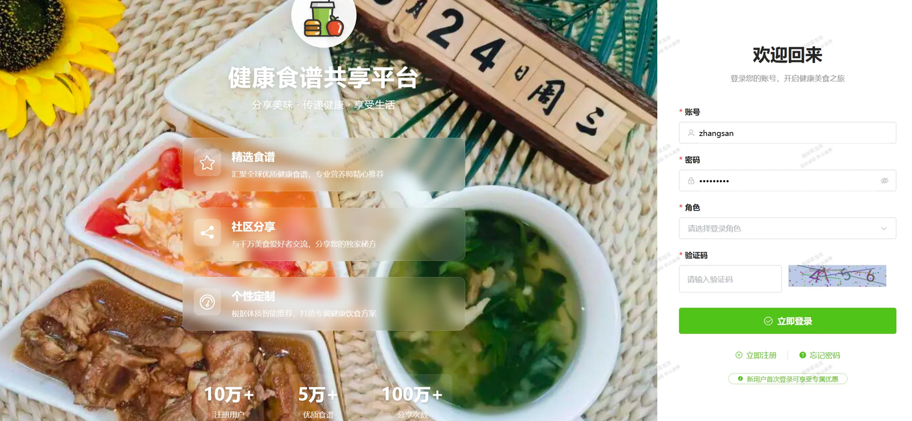

**登录页**：账号、密码、角色下拉、验证码四项，三种身份同一个入口。左侧是平台介绍卡——精选食谱（专业营养师推荐）、社区分享（交流独家秘方）、个性定制（按体质智能推荐），底部压着 10 万+ 注册用户、5 万+ 优质食谱、100 万+ 互动数据。

### 一、用户端

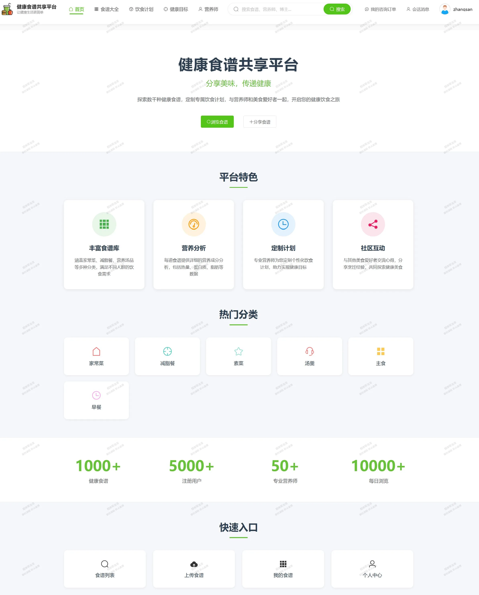

**首页**：顶部导航是首页、食谱大全、饮食计划、健康目标、营养师，右侧挂「我的咨询订单」和「会话消息」两个入口。往下是平台特色四张卡（丰富食谱库、营养分析、定制计划、社区互动）、热门分类六项（家常菜、减脂餐、素菜、汤羹、主食、早餐），以及 1000+ 健康食谱、5000+ 注册用户、50+ 专业营养师、10000+ 每日浏览四个数字。底部快速入口直通食谱列表、上传食谱、我的食谱、个人中心。

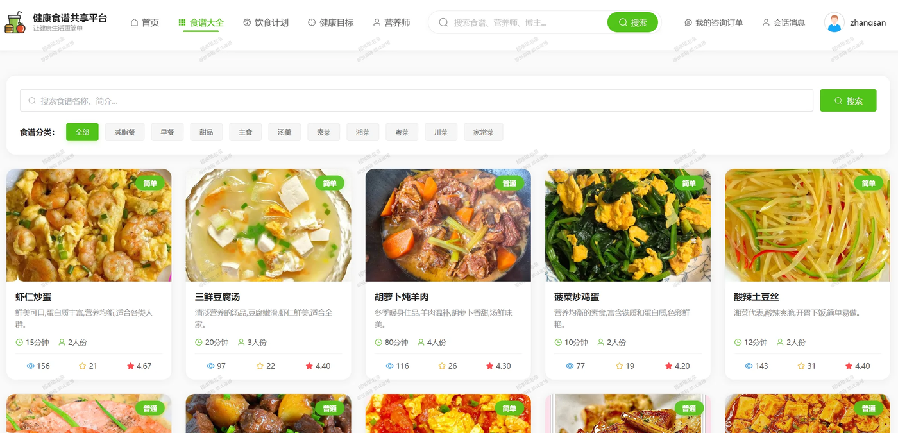

**食谱大全**：分类条按口味和场景切了 11 项（全部、减脂餐、早餐、甜品、主食、汤羹、素菜、湘菜、粤菜、川菜、家常菜）。每张卡片固定给四个信息——难度标签（简单）、时长、人份、点赞数、收藏数、星级评分，比如虾仁炒蛋 15 分钟 / 2 人份 / 156 赞 / 21 收藏 / 4.67 分。

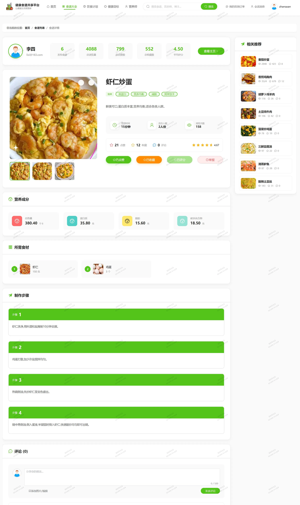

**食谱详情**：左边是主图和步骤，右边一栏是「相关推荐」——这就是协同过滤的输出，按当前这道虾仁炒蛋推了 8 道菜，每条带点赞数。页面上半部分是作者数据（6 个优质食谱、4088 获赞、799 总收藏、552 平均浏览、4.50 平均评分）；营养成分为总热量 380.40 千卡、蛋白质 35.80 克、脂肪 15.60 克、碳水 18.50 克；所需食材写明虾仁 250g、鸡蛋 3 个，下面接 4 步做法和评论区。

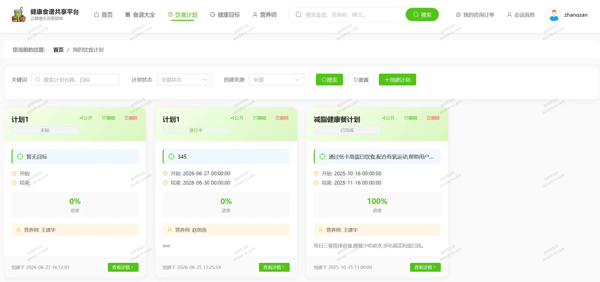

**饮食计划**：三张计划卡并排，每张都带公开状态、编辑/删除按钮、计划状态（未知 / 进行中 / 已完成）、计划目标、起止日期、完成进度和负责的营养师。已完成的那张进度是 100%，说明里写着「每日三餐规律进食，减少吃碳水，多吃蔬菜和蛋白质」。

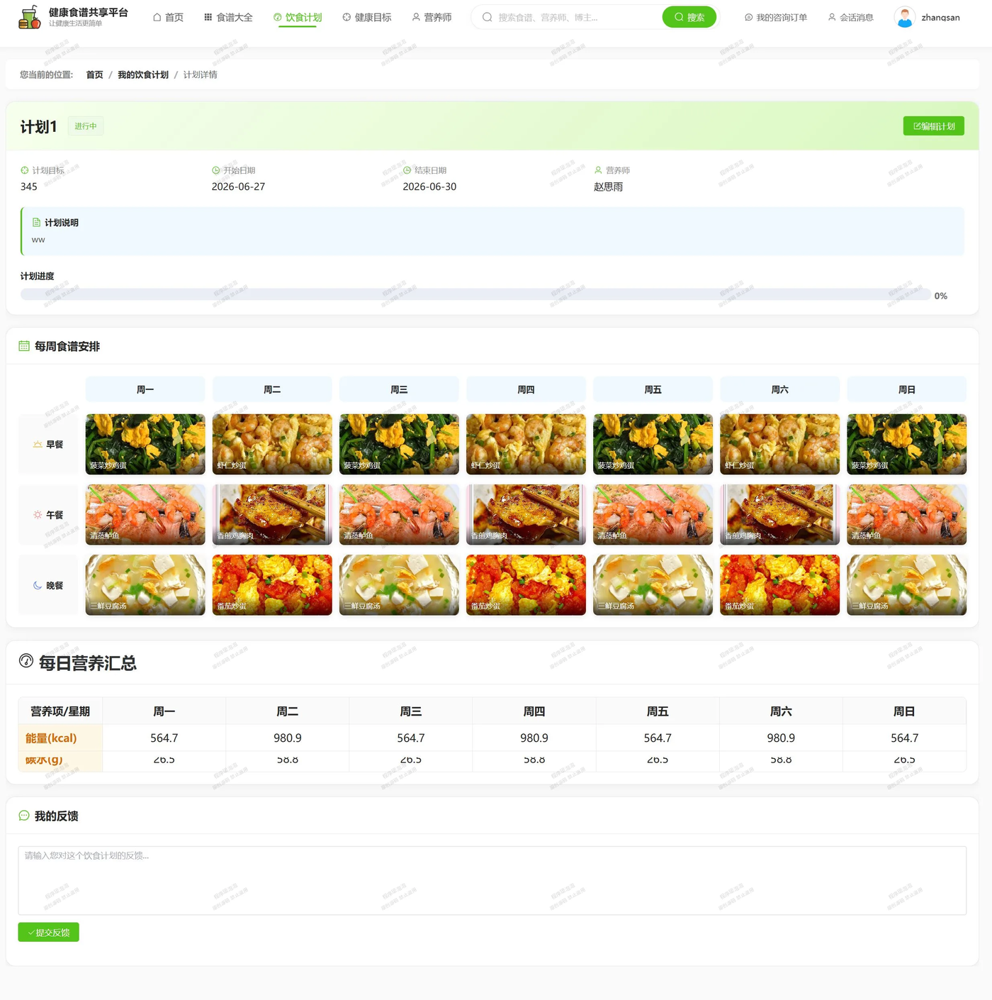

**饮食计划详情**：顶部是计划目标、起止日期、营养师、计划说明和进度条；中间「每周食谱安排」用一张表把周一到周日、早餐/午餐/晚餐 21 个格子铺开，每格是一道菜的缩略图；下面「每日营养汇总」按天列出能量（千卡），最后留了「我的反馈」输入框，用户可以回填执行情况。

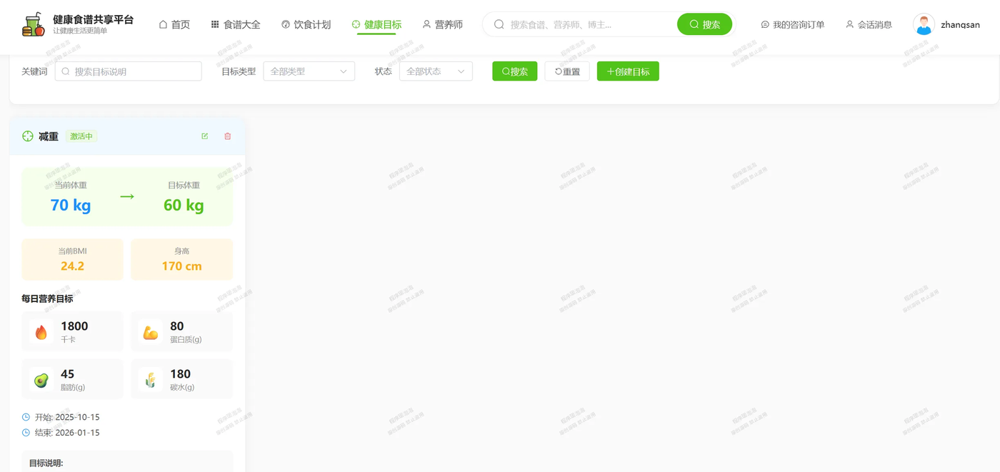

**健康目标**：这是一个减重目标——当前体重 70kg、目标 60kg、当前 BMI 24.2、身高 170cm，每日营养目标拆成 1800 千卡、蛋白质 80g、脂肪 45g、碳水 180g，周期从 2025-10-15 到 2026-01-15。饮食计划里那份「每日营养汇总」，分母就来自这张表。

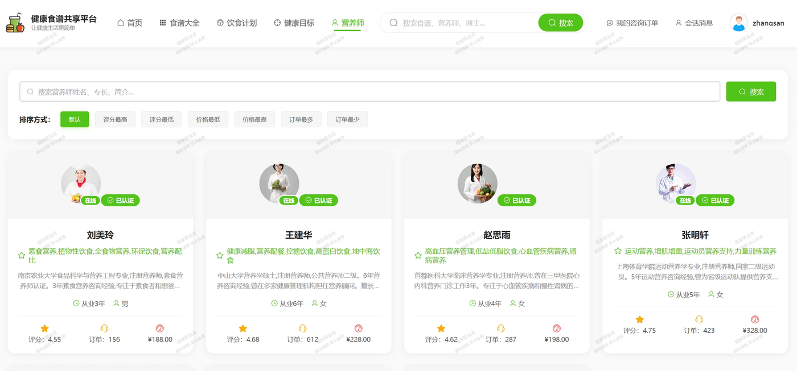

**营养师列表**：排序给了 7 种（默认、评分最高/最低、价格最低/最高、订单最多/最少）。四位认证营养师的卡片都写明擅长标签、执业背景、从业年限，底部是评分、订单数、咨询价格，例如王建华 4.68 分 / 612 单 / ¥228.00，赵思雨 4.62 分 / 287 单 / ¥198.00。

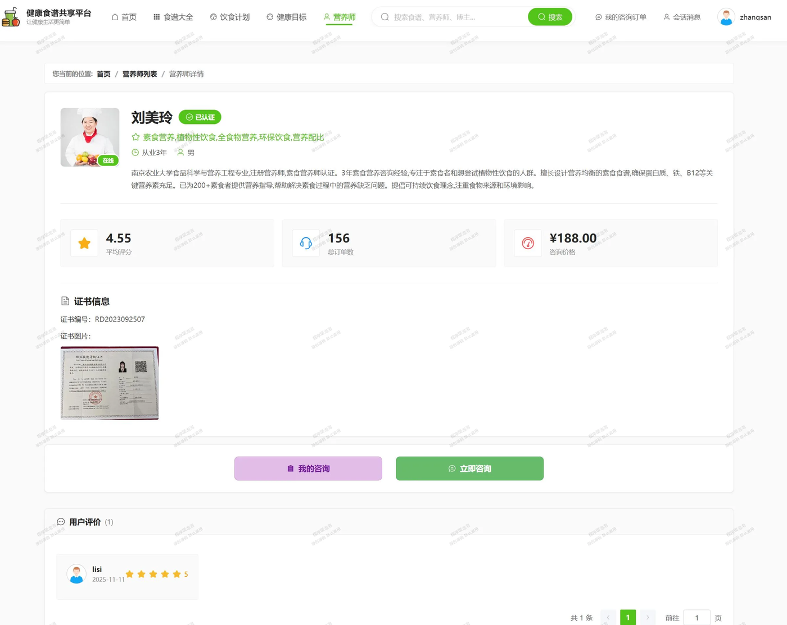

**营养师详情**：刘美玲，已认证，擅长素食营养、植物性食品、全食物营养、营养配比，从业 3 年。三项数据是 4.55 平均评分、156 总订单、¥188.00 咨询价格；中间有证书信息（证书编号 RD2023092507 和证书图片），底部是用户评价列表和「我的咨询 / 立即咨询」两个按钮。

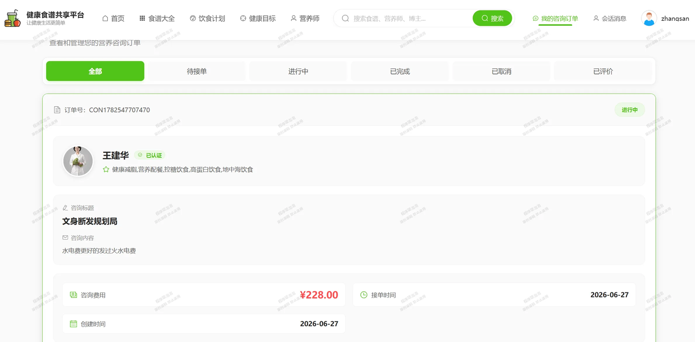

**我的咨询订单**：顶部按状态分了六格——全部、待接单、进行中、已完成、已取消、已评价。每张订单卡给出订单号、营养师及其擅长标签、「咨询标题 / 咨询内容」、咨询费用、接单时间、创建时间，当前这条是「进行中」。

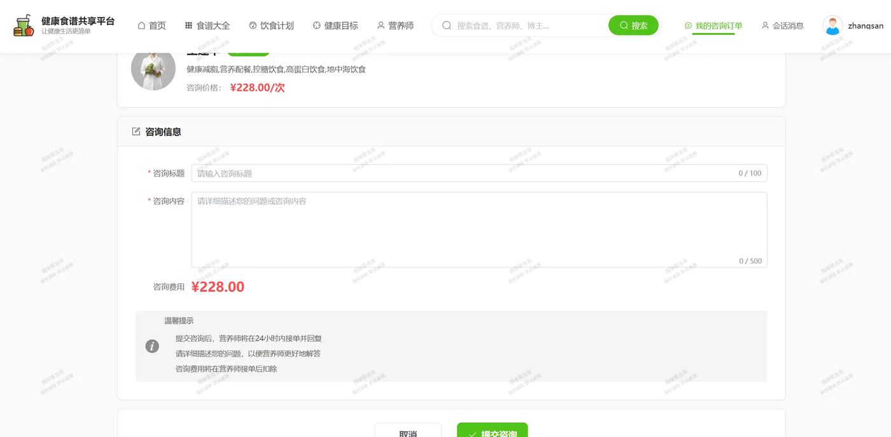

**发起咨询**：选好营养师后进入这个表单，咨询标题限 100 字、咨询内容限 500 字，费用按营养师定价带出（这里 ¥228.00）。下方三条温馨提示写得比较实在：提交后营养师 24 小时内接单并回复；描述得越细越好解答；**咨询费用在营养师接单后才扣除**——这也是订单状态从「待接单」转「进行中」的时点。

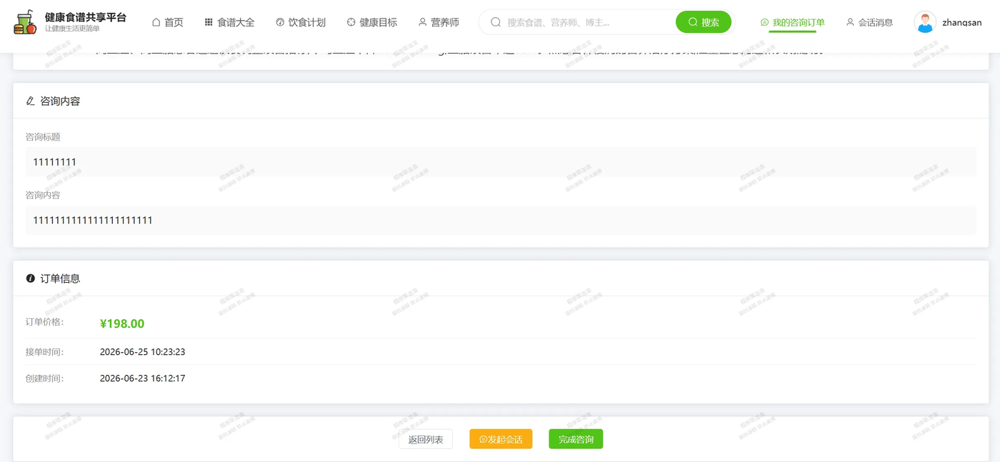

**咨询详情**：上半部分是用户填的咨询标题和内容，下半部分「订单信息」给出订单价格、接单时间、创建时间（这笔 ¥198.00，2026-06-25 接单、2026-06-23 创建）。底部三个按钮是返回列表、发起会话、完成咨询，最后一步「完成咨询」之后才会出现评价入口。

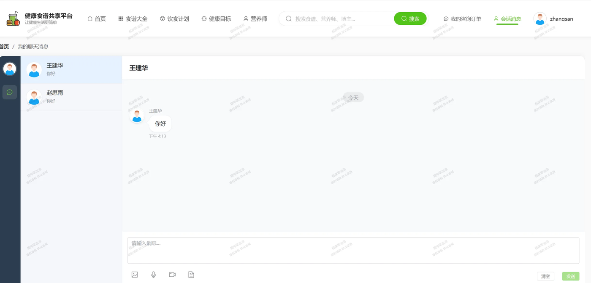

**会话消息**：左侧是会话列表（按营养师分组，带最后一条消息预览），右侧是消息区。输入框下方一排图标是表情、语音、视频、文件——对应 WebSocket 支持的几类消息，聊天记录通过 WebSocket 实时推送。

### 二、营养师端

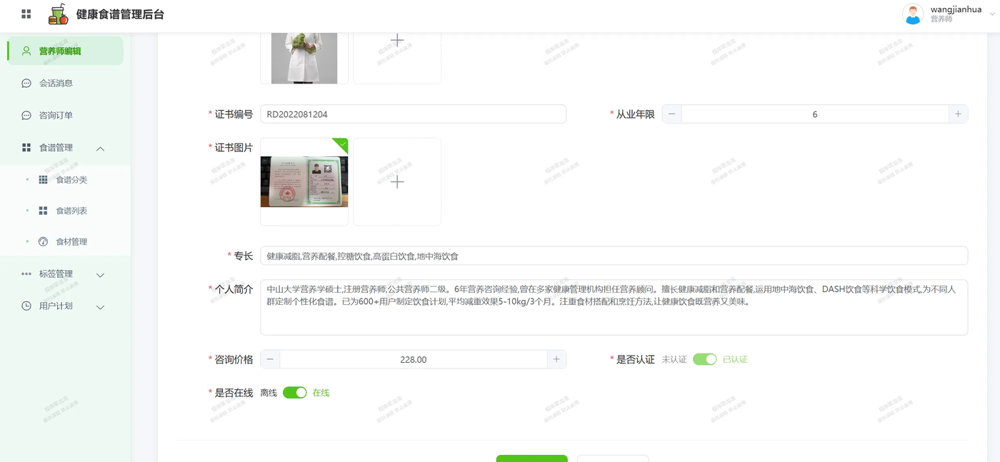

**营养师编辑**：个人资料页，字段包括证书编号（RD2022081204）、从业年限（6 年）、证书图片、专长标签、个人简介、咨询价格（228.00），最后两个开关是「是否认证」和「是否在线」。是否在线直接决定用户端能不能发起咨询。

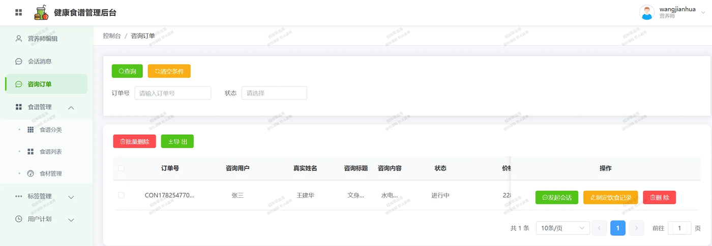

**咨询订单**：营养师侧的订单表，列是订单号、咨询用户、真实姓名、咨询标题、咨询内容、状态、价格，操作列三个按钮——「发起会话」「制定饮食计划」「拒绝」。咨询转到饮食计划就是从这里点的，用户付的钱、聊的天、拿到的计划能对上同一个订单号。

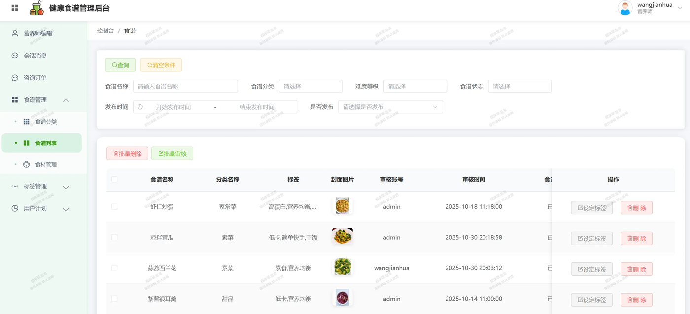

**食谱列表**：按食谱名称、分类、难度、状态、发布时间、是否发布筛选，支持批量删除和批量审核。表格里除了食谱本身，还留着「审核账号」和「审核时间」两列，能看出这条食谱是谁审的、什么时候过审。

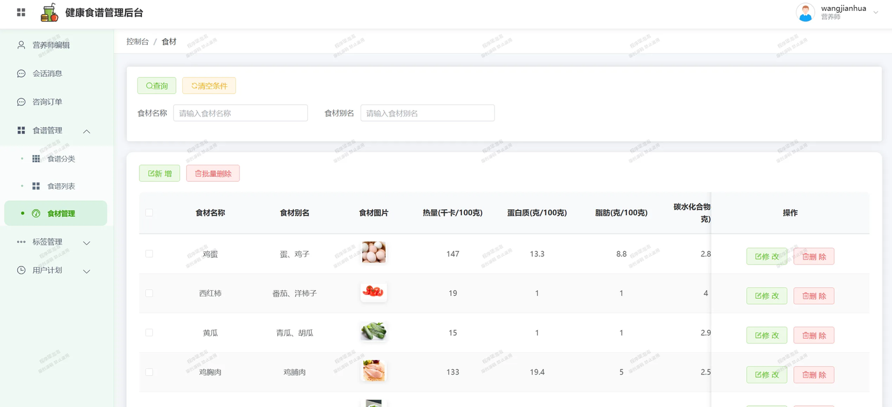

**食材管理**：食材表按每 100 克记四项营养——鸡蛋 147 千卡 / 13.3 蛋白 / 8.8 脂肪 / 2.8 碳水，西红柿 19 / 1 / 1 / 4，黄瓜 15 / 1 / 1 / 2.9，鸡胸肉 133 / 19.4 / 5 / 2.5。食谱的营养成分和饮食计划的每日汇总，都是拿这份表按用量折算出来的。

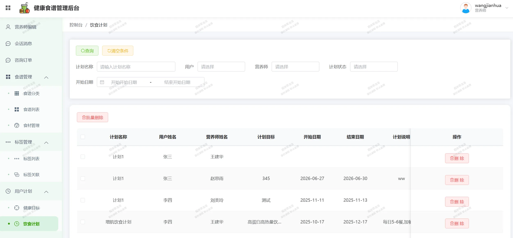

**饮食计划**：营养师给自己服务的用户建的计划表，列出计划名称、用户姓名、营养师姓名、计划目标、起止日期和计划说明，比如「增肌饮食计划 / 李四 / 王建华 / 高蛋白高热量… / 2025-10-17 至 2025-12-17」，说明里写着「每日 5-6 餐，加餐」。用户在端内看到的计划卡就是这些记录。

### 三、管理员端

> 源文档 2.3.4 标注「食谱管理」，截图实际是「食材管理」，内容与营养师端的食材表完全一致（同一批鸡蛋、西红柿、黄瓜、鸡胸肉），属重复画面，这里不重复列出。

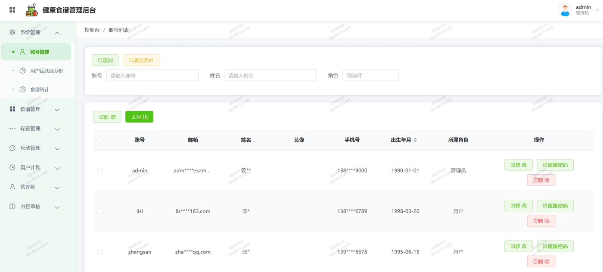

**账号管理**：账号、邮箱、姓名、头像、手机号、出生年月、所属角色一张表，操作是修改、重置密码、删除。角色列能看到 admin、lisi、zhangsan 分别对应管理员和普通用户，三种身份在同一个账号体系里。

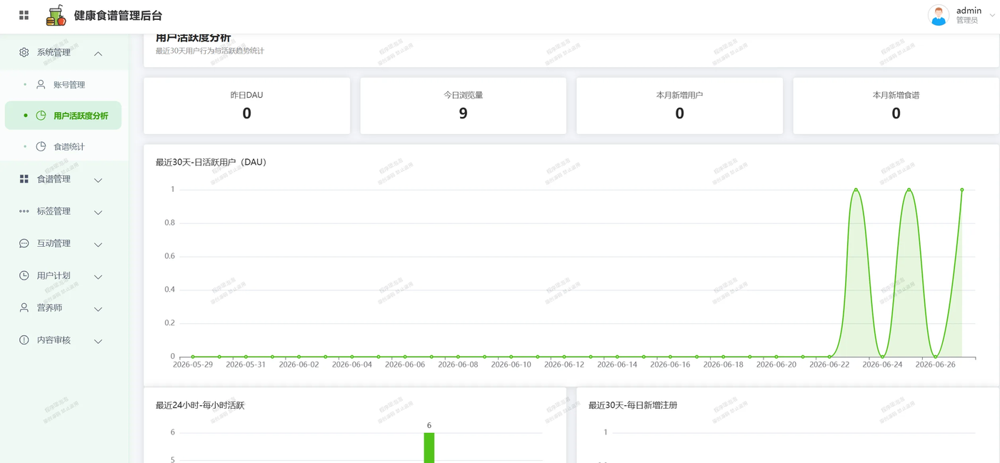

**用户活跃度分析**：顶部四个数——昨日 DAU、今日浏览量、本月新增用户、本月新增食谱。下面三张 ECharts：近 30 天日活跃用户折线、近 24 小时每小时活跃柱状、近 30 天每日新增注册。截图里 6 月 22 日到 26 日 DAU 有明显波峰，是测试期集中访问留下的。

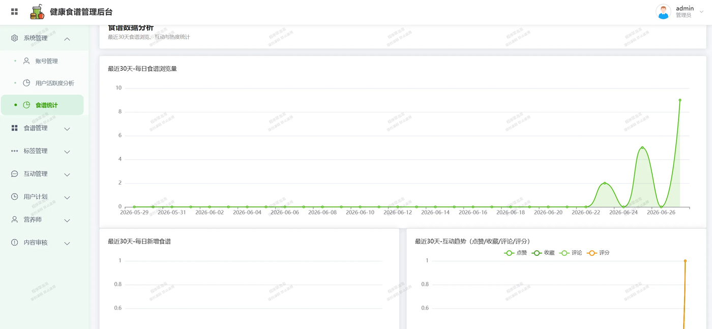

**食谱数据分析**：近 30 天每日食谱浏览量折线、每日新增食谱柱状，以及「互动趋势」——点赞、收藏、评论、评分四条线画在同一张图上，方便看哪类互动先起来。

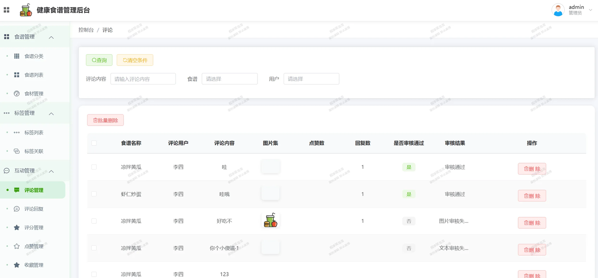

**互动管理（评论管理）**：评论区按食谱、用户、评论内容筛选，表格给出点赞数、回复数、是否审核通过和审核结果。这里能直接看到 AI 审核的三种结论——「审核通过」「图片审核失败」「文本审核失败」，失败的评论仍在列表里，管理员可以再删除。

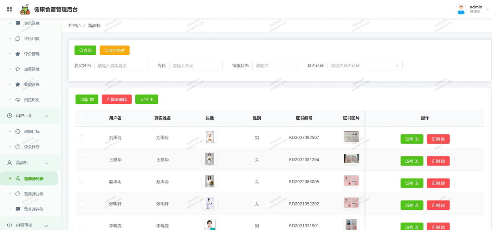

**营养师列表**：管理员侧的资质台账，列是用户名、真实姓名、头像、性别、证书编号、证书图片，支持新增、批量删除、导入。证书编号这一列可以和用户端、营养师端对上（刘美玲 RD2023092507、王建华 RD2022081204），说明是同一份数据。

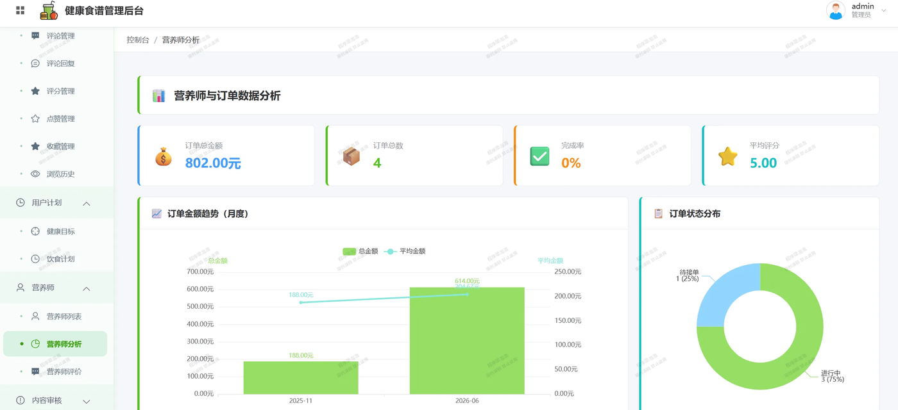

**营养师与订单数据分析**：四个指标卡是订单总金额 802.00 元、订单总数 4、完成率 0%、平均评分 5.00。左边柱线图按月看订单金额（2025-11 为 180.00 元，2026-06 为 614.00 元），右边环形图是订单状态分布——待接单 1 单占 25%，进行中 3 单占 75%。

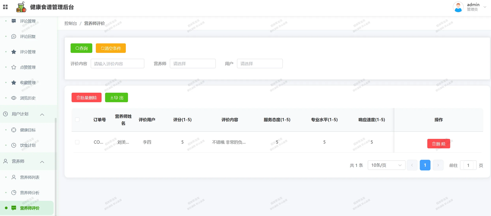

**营养师评价**：一条评价拆成四项打分——总评分、服务态度、专业水平、响应速度，都按 1-5 分记，后面跟评价内容和所属订单号。比只给一个总分更容易看出营养师弱在哪。

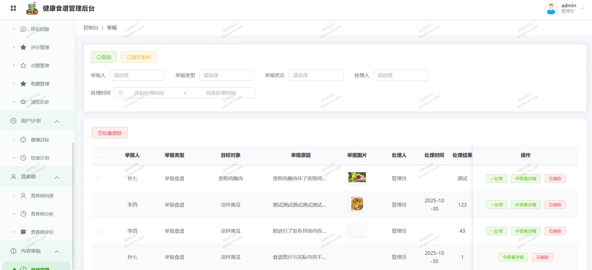

**举报管理**：列出举报人、举报类型、目标对象、举报原因、举报图片、处理人、处理时间、处理结果，操作是处理、查看详情、删除。截图里的举报类型都是「举报食谱」，处理人是管理员。

## 几处可以互相对上的数据

- **刘美玲**：用户端营养师详情是 4.55 分 / 156 单 / ¥188.00，管理员营养师列表里同一人的证书编号是 RD2023092507，两边是同一条记录。
- **王建华**：用户端列表 4.68 分 / 612 单 / ¥228.00，发起咨询页费用 ¥228.00/次，营养师编辑页咨询价格 228.00，咨询订单价格也是 228.00，四个页面同一个价。
- **赵思雨**：用户端列表报价 ¥198.00，用户端咨询详情的订单价格正好是 ¥198.00。
- **食材表**：营养师端食材管理（每 100 克）是营养汇总的计算口径，饮食计划详情里按餐次汇总的能量就按这份表折算。
- **饮食计划**：用户端「减脂健康餐计划」的营养师是王建华，营养师端饮食计划表里也有「李四 / 王建华」这条，前台看到的卡就是后台这张表。

## 说明

- 部分截图里的文字是演示占位，比如咨询标题「11111111」、咨询内容里的乱码、用户名张三和李四。文案只描述字段和流程，不引用这些值。
- 营养师端咨询订单表的「真实姓名」列填的是当前登录营养师（王建华）的名字，不是咨询用户的真名。
- 截图里的水分/浏览数据属于测试数据，文案没有据此下「某天涨了多少」这类结论。

文档展示 26 张截图，需要了解更多，请联系我。

